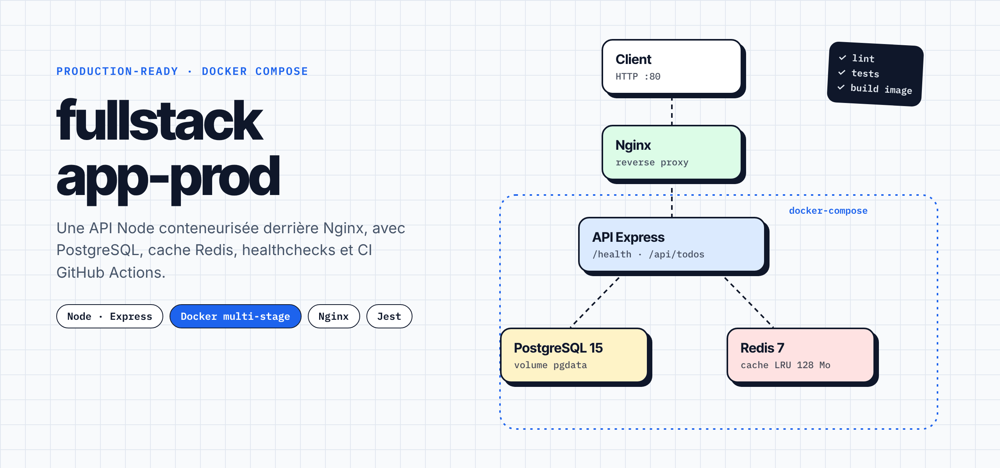
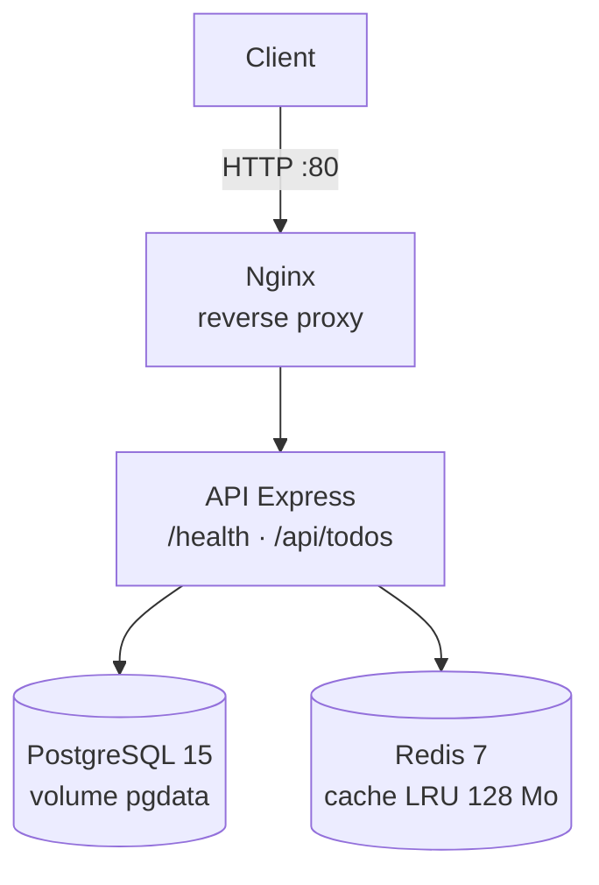

<p align="center">
  
</p>

# fullstack-app-prod

Une API Node.js / Express prête pour la production : conteneurisée avec Docker, servie derrière un reverse proxy Nginx, avec PostgreSQL, un cache Redis, des healthchecks et une pipeline CI/CD GitHub Actions.

## Architecture



## Points clés

- **Dockerfile multi-stage** : image de prod légère, dépendances de dev retirées, exécution avec un utilisateur non-root
- **Healthchecks** : la route `/health` vérifie PostgreSQL et Redis ; l'API attend que la base soit saine avant de démarrer
- **Redis** limité à 128 Mo avec éviction LRU
- **CI/CD** : lint + tests avec couverture, puis build et push de l'image sur GHCR et scan de vulnérabilités Trivy

## Stack

Node.js 20 · Express · PostgreSQL · Redis · Nginx · Docker Compose · Jest · Supertest · GitHub Actions

## Lancer le projet

```bash
cp .env.example .env
docker compose up -d --build
```

L'API répond sur [http://localhost](http://localhost) (via Nginx) et `GET /health` renvoie l'état de la base et du cache.

Sans Docker :

```bash
npm install
npm start
npm test
```

## Structure

```
src/server.js        routes Express (/health, /api/todos)
src/db.js            connexions PostgreSQL et Redis
nginx/default.conf   configuration du reverse proxy
tests/               tests d'API (Jest + Supertest)
.github/workflows/   pipeline CI/CD
```
